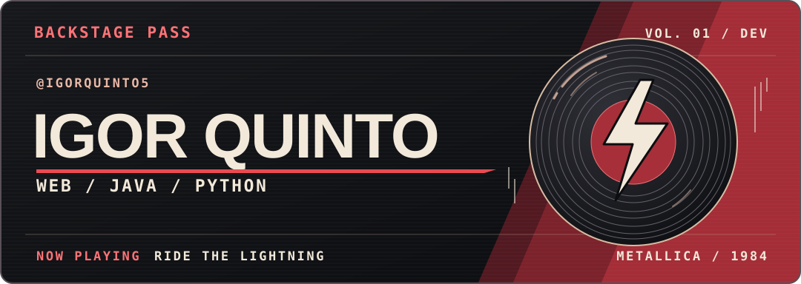
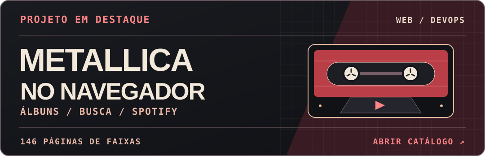
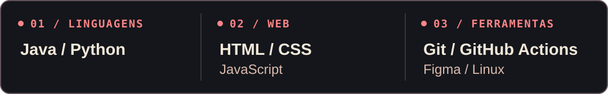

<p align="center">
  <a href="#por-trás-do-código">Sobre mim</a> &nbsp;·&nbsp;
  <a href="#projetos-em-destaque">Projetos</a> &nbsp;·&nbsp;
  <a href="#metallica-no-navegador">Metallica no navegador</a> &nbsp;·&nbsp;
  <a href="#bancada-de-desenvolvimento">Tecnologias</a> &nbsp;·&nbsp;
  <a href="https://www.instagram.com/itzz_igor.7/">Instagram</a>
</p>



## Por trás do código

Sou **Igor Quinto**, estudante de ADS na Germinare Tech. Java e Python são as linguagens com que tenho mais prática. Também gosto de construir interfaces e usar JavaScript para dar vida às páginas.

```python
perfil = {
    "nome": "Igor Quinto",
    "formacao": "ADS na Germinare Tech",
    "linguagens": ["Java", "Python", "JavaScript"],
    "trilha_sonora": "Metallica",
}
```

## Projetos em destaque

### EI Truck

Projeto em equipe voltado à **gestão de frotas e operações de transporte**. A solução reúne um portal web em React para consulta de dados logísticos e um aplicativo Android em Kotlin para acompanhar viagens, ocorrências e indicadores de desempenho.

[Portal web](https://github.com/Ei-Truck/Portal-Eitruck) · [Aplicativo Android](https://github.com/Ei-Truck/Mobile)

### Astro

Plataforma de **gestão de conformidade e Segurança e Saúde no Trabalho (SST)**. No front-end em React e TypeScript, contribuí com ajustes nos filtros de formulários e nos atalhos de conformidade. O sistema centraliza a gestão de colaboradores, unidades, cargos, eventos e formulários.

[Repositório web](https://github.com/Astro-Inter/astro-web) · [Aplicação publicada](https://astro-inter.github.io/astro-web/)

## Metallica no navegador

<a href="https://igorquinto5.github.io/Site-de-m-sica/">
  
</a>

O catálogo reúne **146 páginas de faixas**, com busca na página inicial e players do Spotify. A cada atualização na branch principal, o GitHub Actions verifica os links internos e, se a validação passar, publica o site no GitHub Pages.

**[Abrir o catálogo →](https://igorquinto5.github.io/Site-de-m-sica/)** &nbsp;·&nbsp; [Ver o código](https://github.com/IgorQuinto5/Site-de-m-sica)

<details>
<summary><strong>Dos bastidores · como o deploy funciona</strong></summary>

```text
Pull request para main ──► valida páginas e links
Push na main ────────────► valida páginas e links
                            └──► empacota e publica no Pages
```

O validador usa Python e roda no GitHub Actions. Ele bloqueia a publicação se faltar uma página referenciada no catálogo.

[Ver o workflow](https://github.com/IgorQuinto5/Site-de-m-sica/blob/main/.github/workflows/ci-cd.yml) · [Ver as execuções](https://github.com/IgorQuinto5/Site-de-m-sica/actions)

</details>

## Bancada de desenvolvimento


